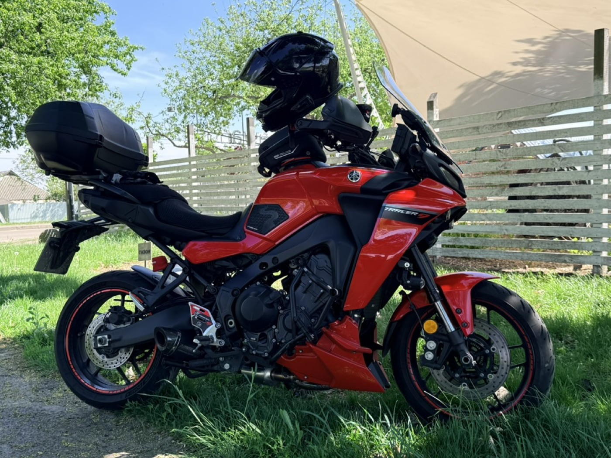

# yamaha-cp3-can — Yamaha Tracer 9 CAN bus decode

The CAN bus of the Yamaha Tracer 9 (2021–2024 generation, CP3 890 cc engine), decoded by
listening at the diagnostic connector: 18 broadcast frames, the OBD-II PIDs the engine ECU
answers, and the read-only UDS identifiers of the engine and ABS units. The MT-09, XSR900 and
Niken GT of the same generation share the platform but are not checked yet.

What is here: a **DBC file** (for SavvyCAN, cantools, Kvaser, PCAN), one page per CAN ID with
layout, formula and evidence, sample `candump` captures, and a dependency-free Python decoder.
Engine speed, gear, throttle, wheel speeds, brake pressure, ABS, traction control, ride mode,
quickshifter and brake-control settings, the 6-axis IMU (lean angle, yaw rate, acceleration)
and temperatures are all in the [table below](#all-signals-at-a-glance).

Use it to build your own dash, data logger (ESP32 / TWAI, Raspberry Pi, any SocketCAN
adapter), lap timer feed or ride analysis.

> **Read-only.** Nothing here writes to the motorcycle, and the project does not accept
> anything that does. Wiring into a vehicle bus is at your own risk. Read
> [DISCLAIMER.md](DISCLAIMER.md) first.

## What was tested

| Model | Code | Year | Market | Engine ECU software | Status |
|---|---|---|---|---|---|
| Tracer 9 (base) | RN70 | 2022 | EU, Euro 5 | 12165003 | everything in this repository |



That is one motorcycle, the one in the photo. Its electronics are factory standard; it has an
aftermarket exhaust, a top case and bags (details in [docs/methodology.md](docs/methodology.md)). 

Every other bike of this generation is unchecked, and every one of them is welcome: another
Tracer 9 of any trim (base, GT, GT+), year or market, the MT-09 and MT-09 SP, the XSR900 and
the Niken GT. They share the engine and electronics platform and probably share most of these
frames, but nobody has checked. A second base Tracer 9 is as useful as a GT: it tells us
whether what is here holds beyond one bike. A one-minute capture settles it: see
[CONTRIBUTING.md](CONTRIBUTING.md).

## What you get

| Quantity | Frame | Rate | Status |
|---|---|---|---|
| Engine speed | [0x209](docs/messages/0x209.md) | 100 Hz | confirmed |
| Gear (sensor and shift mechanism) | [0x209](docs/messages/0x209.md) | 100 Hz | confirmed |
| Riding mode, traction-control mode and level | [0x209](docs/messages/0x209.md), [0x226](docs/messages/0x226.md) | 100 Hz | confirmed |
| Quickshifter on/off, brake-control mode (BC1/BC2) | [0x226](docs/messages/0x226.md) | 100 Hz | confirmed |
| Front and rear wheel speed, wheel slip | [0x205](docs/messages/0x205.md) | 100 Hz | confirmed |
| Throttle grip and throttle valve | [0x215](docs/messages/0x215.md) | 100 Hz | grip confirmed, valve hypothesis |
| Front brake pressure (front circuit only) | [0x260](docs/messages/0x260.md) | 100 Hz | confirmed (raw units) |
| ABS front / rear intervention, brake light switch | [0x268](docs/messages/0x268.md) | 100 Hz | confirmed |
| Acceleration, 3 axes | [0x250](docs/messages/0x250.md) | 100 Hz | confirmed |
| Roll, pitch and yaw rate | [0x254](docs/messages/0x254.md) | 100 Hz | confirmed |
| **Lean angle** (reconstructed) | [0x254](docs/messages/0x254.md) + 0x205 | 100 Hz | confirmed, with limits |
| Coolant and air temperature | [0x23E](docs/messages/0x23E.md) | 1 Hz | confirmed |
| Battery voltage, intake pressure, fuel trims and more | [OBD-II](docs/obd2.md) | on request | confirmed |

Every signal, with its bytes and formula, is in the [table below](#all-signals-at-a-glance) and,
with evidence, in [docs/signals.md](docs/signals.md). What we do not know is in
[docs/open-questions.md](docs/open-questions.md): the odometer, oil temperature, cruise
control state and several whole frames are still open.

The bike does not broadcast a lean angle. [docs/lean-reconstruction.md](docs/lean-reconstruction.md)
shows how to get one from yaw rate and wheel speed, and how far to trust it.

## All signals at a glance

The table above says what you get; this one says where it is. Every confirmed or hypothesis
signal on the broadcast frames, with its bytes and formula, so this page alone is enough to
start decoding. Bytes are numbered from 0, multi-byte values are big-endian, and
`value = raw × scale + offset`. Unknown bits, the evidence and an example frame are on each ID's
page.

<!-- BEGIN GENERATED: signals at a glance (tools/gen_docs.py) -->
<details>
<summary>Bytes and formulas for every confirmed and hypothesis signal</summary>

| ID | Hz | Where | Signal | Value | Unit | Status |
|---|---|---|---|---|---|---|
| [0x205](docs/messages/0x205.md) | 100 | B0:B1 | `wheel_speed_front` | raw × 0.00990099 | km/h | confirmed (high) |
| [0x205](docs/messages/0x205.md) | 100 | B2:B3 | `wheel_speed_rear` | raw × 0.00990099 | km/h | confirmed (medium) |
| [0x205](docs/messages/0x205.md) | 100 | B5 bits 3..1 | `accel_level` | 0 = level 0 (decelerating), 1 = level 4, 2 = level 2, 3 = level 6, 4 = level 1, … |  | hypothesis (medium) |
| [0x205](docs/messages/0x205.md) | | derived | `wheel_slip` | `wheel_speed_rear - wheel_speed_front` | km/h | confirmed (high) |
| [0x209](docs/messages/0x209.md) | 100 | B0:B1 | `engine_rpm` | raw × 0.390625 | rpm | confirmed (high) |
| [0x209](docs/messages/0x209.md) | 100 | B3 bits 7..5 | `gear_actual` | 0 = neutral, 1 = 1st, 2 = 2nd, 3 = 3rd, 4 = 4th, 5 = 5th, 6 = 6th | gear | confirmed (high) |
| [0x209](docs/messages/0x209.md) | 100 | B3 bits 4..1 | `tcs_level` | 0 = probably TCS OFF (not confirmed), 1 = TCS level 1, 2 = TCS level 2, 3 = TCS level 3 |  | confirmed (high) |
| [0x209](docs/messages/0x209.md) | 100 | B3 bit 0 | `start_flag` | raw |  | hypothesis (medium) |
| [0x209](docs/messages/0x209.md) | 100 | B4 bits 2..0 | `gear_requested` | 0 = neutral, 1 = 1st, 2 = 2nd, 3 = 3rd, 4 = 4th, 5 = 5th, 6 = 6th, 7 = between gears | gear | confirmed (high) |
| [0x209](docs/messages/0x209.md) | 100 | B4 bits 7..6 | `ride_mode` | 0 = D-MODE 1, 1 = D-MODE 2, 2 = D-MODE 3, 3 = D-MODE 4 |  | confirmed (medium) |
| [0x209](docs/messages/0x209.md) | 100 | B5 bits 3..2 | `shift_window_bits` | 0 = neither, 1 = bit 2 only, 2 = bit 3 only |  | hypothesis (medium) |
| [0x215](docs/messages/0x215.md) | 100 | B0:B1 | `throttle_valve` | raw | raw | hypothesis (medium) |
| [0x215](docs/messages/0x215.md) | 100 | B2:B3 | `throttle_grip` | raw | raw | confirmed (medium) |
| [0x215](docs/messages/0x215.md) | 100 | B4 bits 1..0 | `tcs_mode` | raw |  | confirmed (medium) |
| [0x215](docs/messages/0x215.md) | 100 | B4 bit 5 | `grip_closed` | raw |  | confirmed (medium) |
| [0x215](docs/messages/0x215.md) | 100 | B5 bits 1..0 | `assist_level_b` | raw |  | hypothesis (medium) |
| [0x215](docs/messages/0x215.md) | 100 | B5 bit 3 | `qs_down_enabled` | raw |  | confirmed (medium) |
| [0x215](docs/messages/0x215.md) | 100 | B5 bit 5 | `qs_up_enabled` | raw |  | confirmed (medium) |
| [0x215](docs/messages/0x215.md) | 100 | B6 bits 2..1 | `tcs_level` | raw |  | confirmed (medium) |
| [0x215](docs/messages/0x215.md) | 100 | B7 bits 7..6 | `ride_mode` | 0 = D-MODE 1, 1 = D-MODE 2, 2 = D-MODE 3, 3 = D-MODE 4 |  | confirmed (medium) |
| [0x226](docs/messages/0x226.md) | 100 | B0 bits 7..6 | `ride_mode` | 0 = D-MODE 1, 1 = D-MODE 2, 2 = D-MODE 3, 3 = D-MODE 4 |  | confirmed (medium) |
| [0x226](docs/messages/0x226.md) | 100 | B0 bits 3..2 | `tcs_level` | 0 = probably TCS OFF (not confirmed), 1 = TCS level 1, 2 = TCS level 2, 3 = TCS level 3 |  | confirmed (high) |
| [0x226](docs/messages/0x226.md) | 100 | B0 bits 1..0 | `assist_level_a` | 1 = level 1, 2 = level 2, 3 = level 3 |  | hypothesis (medium) |
| [0x226](docs/messages/0x226.md) | 100 | B1 bit 0 | `qs_down_enabled` | 0 = off, 1 = on |  | confirmed (medium) |
| [0x226](docs/messages/0x226.md) | 100 | B3 | `tcs_mode` | 0 = probably TCS OFF (not confirmed), 1 = TCS 1, 2 = TCS 2, 3 = TCS M (manual) |  | confirmed (high) |
| [0x226](docs/messages/0x226.md) | 100 | B5 bits 1..0 | `bc_mode` | 1 = BC1, 2 = BC2 |  | confirmed (high) |
| [0x226](docs/messages/0x226.md) | 100 | B5 bits 3..2 | `assist_level_b` | 1 = level 1, 2 = level 2, 3 = level 3 |  | hypothesis (medium) |
| [0x226](docs/messages/0x226.md) | 100 | B5 bit 5 | `qs_up_enabled` | 0 = off, 1 = on |  | confirmed (medium) |
| [0x22A](docs/messages/0x22A.md) | 10 | B1 bit 3 | `brake_switch` | raw |  | confirmed (medium) |
| [0x23A](docs/messages/0x23A.md) | 10 | B0 | `wake_phase` | 0 = normal, 4 = just woken |  | hypothesis (low) |
| [0x23E](docs/messages/0x23E.md) | 1 | B0 | `coolant_temp` | raw × 0.625 − 30 | degC | confirmed (high) |
| [0x23E](docs/messages/0x23E.md) | 1 | B1 | `ambient_temp` | raw × 0.625 − 30 | degC | confirmed (medium) |
| [0x23E](docs/messages/0x23E.md) | 1 | B2:B3 | `load_counter` | raw | raw | hypothesis (low) |
| [0x250](docs/messages/0x250.md) | 100 | B0:B1 | `accel_x` | raw × 0.001008 − 7.056 | g | confirmed (medium) |
| [0x250](docs/messages/0x250.md) | 100 | B2:B3 | `accel_y` | raw × 0.001008 − 7.056 | g | confirmed (medium) |
| [0x250](docs/messages/0x250.md) | 100 | B4:B5 | `accel_z` | raw × 0.001008 − 7.056 | g | confirmed (medium) |
| [0x250](docs/messages/0x250.md) | 100 | B2:B3 | `lean_static` | raw × -0.057412 + 402.59 | deg | confirmed (high) |
| [0x250](docs/messages/0x250.md) | 100 | B6 | `power_up_flags` | 32 = normal, 96 = first 0.4 s after power-up, 128 = first frame |  | hypothesis (medium) |
| [0x254](docs/messages/0x254.md) | 100 | B0:B1 | `roll_rate` | raw × 0.01 − 300 | deg/s | confirmed (medium) |
| [0x254](docs/messages/0x254.md) | 100 | B2:B3 | `pitch_rate` | raw × 0.01 − 300 | deg/s | confirmed (medium) |
| [0x254](docs/messages/0x254.md) | 100 | B4:B5 | `yaw_rate` | raw × 0.01 − 300 | deg/s | confirmed (medium) |
| [0x254](docs/messages/0x254.md) | | derived | `lean_angle` | `atan((yaw_raw - 30000) * v / 45873), v = wheel_speed_front in m/s` | deg | confirmed (medium) |
| [0x258](docs/messages/0x258.md) | 100 | B6:B7 | `pitch_rate_level` | raw × 0.01 − 300 | deg/s | hypothesis (medium) |
| [0x260](docs/messages/0x260.md) | 100 | B0:B1 | `brake_pressure_front` | raw | raw | confirmed (high) |
| [0x268](docs/messages/0x268.md) | 100 | B1 bit 0 | `not_moved_since_start` | raw |  | hypothesis (medium) |
| [0x268](docs/messages/0x268.md) | 100 | B2:B3 | `vehicle_speed` | raw × 0.056497 | km/h | confirmed (medium) |
| [0x268](docs/messages/0x268.md) | 100 | B4 bit 0 | `abs_rear_active` | raw |  | confirmed (high) |
| [0x268](docs/messages/0x268.md) | 100 | B4 bit 1 | `abs_front_active` | raw |  | confirmed (medium) |
| [0x268](docs/messages/0x268.md) | 100 | B4 bit 2 | `brake_switch` | raw |  | confirmed (medium) |
| [0x268](docs/messages/0x268.md) | 100 | B4 bits 4..3 | `bc_mode` | 1 = BC1, 2 = BC2 |  | confirmed (high) |
| [0x401](docs/messages/0x401.md) | 10 | B0 bit 7 | `after_run` | raw |  | hypothesis (medium) |

</details>
<!-- END GENERATED: signals at a glance -->

## Status

Every signal carries a status and, where it applies, a confidence.

| Status | Meaning |
|---|---|
| confirmed | Agrees with an independent reference (dash, GPS, phone sensors, an OBD-II reading or a deliberate rider action), and the agreement was reproduced on a second recording. A field that always equals a confirmed one is confirmed as a copy of it. |
| hypothesis | A pattern in the data that fits, without an independent reference yet. |
| unknown | The bits are on the bus; we do not know what they mean. That includes fields that never changed. |
| ruled out | An earlier reading that the data disproved. Kept so nobody repeats it. |

Confidence is high, medium or low. Medium usually means one ride, one reference, or a scale
known to a few percent only. Each confirmed signal names what it was checked against
("Confirmed by") on its message page and in [docs/signals.md](docs/signals.md); the methods
are in [docs/methodology.md](docs/methodology.md).

## Quick start

Hardware and wiring: [docs/connecting.md](docs/connecting.md). In short:

- **Connector:** the 6-pin Euro 5 diagnostic connector (ISO 19689) under the seat. It carries
  CAN high, CAN low, ground and permanent +12 V; check the pins with a multimeter, the pin numbers
  are from published pinouts, not traced by us ([details](docs/connecting.md)).
- **Bus:** 500 kbit/s, classic CAN, 11-bit IDs. Termination not measured: do not add a 120 Ω
  terminator unless you have measured that the bus needs one.
- **Logger mode:** ours ran in normal mode: it acknowledges frames and sent only read-only
  OBD-II / UDS requests, never broadcast IDs. Listen-only has not been tested on this bike.
- **Transceiver:** any 3.3 V CAN transceiver for an ESP32 (we used an SN65HVD230).

With a Linux SocketCAN adapter and [cantools](https://github.com/cantools/cantools):

```bash
candump can0 | python3 -m cantools decode dbc/yamaha_cp3_2021-2024.dbc
```

With the small decoder in this repository (Python standard library only), on one of the
sample captures:

```bash
python3 decoder/cp3can.py captures/acceleration-through-gears/capture.log --signals engine_rpm,gear_actual,wheel_speed_front
```

In your own code the essentials fit in a few lines:

```c
// 0x209, 6 bytes
rpm  = ((d[0] << 8) | d[1]) * 25 / 64;
gear = d[4] & 0x07;                      // 0 = neutral, 7 = between gears

// 0x205, 8 bytes
front_kmh = ((d[0] << 8) | d[1]) / 101.0;
rear_kmh  = ((d[2] << 8) | d[3]) / 101.0;

// 0x254, 8 bytes
yaw_deg_s = (((d[4] << 8) | d[5]) - 30000) / 100.0;   // positive = left turn
```

## Repository map

| Path | What |
|---|---|
| [data/signals.yaml](data/signals.yaml) | The signal database. Everything else is generated from it or cites it. |
| [dbc/](dbc/) | Generated DBC file for SavvyCAN, cantools, Kvaser, PCAN and the like. |
| [docs/messages/](docs/messages/) | One generated page per CAN ID: layout, formula, evidence, example frame. |
| [docs/connecting.md](docs/connecting.md) | Connector, wiring, what the logger must do. |
| [docs/bus.md](docs/bus.md) | Which frames exist, how often, what happens at power-up and shutdown. |
| [docs/imu.md](docs/imu.md), [docs/lean-reconstruction.md](docs/lean-reconstruction.md) | The inertial unit and the lean angle. |
| [docs/obd2.md](docs/obd2.md), [docs/uds.md](docs/uds.md) | Request/response diagnostics, read-only. |
| [docs/methodology.md](docs/methodology.md) | How signals were found and what counts as confirmed. |
| [docs/prior-art.md](docs/prior-art.md) | Our results compared with other public Yamaha decodes. |
| [captures/](captures/) | Short sample logs in `candump` format with event lists. |
| [decoder/](decoder/) | A dependency-free Python decoder. |

## Contributing

Help is wanted: this is one bike's worth of data, and a good part of the bus is still unknown.

- **Own any bike of this family?** A Tracer 9 of any trim, an MT-09, an XSR900 or a Niken GT,
  any year from 2021, any market. A one-minute capture tells us which frames your bike shares.
- **Curious?** [docs/open-questions.md](docs/open-questions.md) lists what would settle each
  unknown, often a two-minute test with the bike parked.
- **Found a mistake?** Open an issue. Several entries here were wrong before they were right.

How to capture, what to send and how statuses are decided: [CONTRIBUTING.md](CONTRIBUTING.md).

## Licence

Data and documentation (`data/`, `dbc/`, `docs/`, `captures/`) are under
[CC BY 4.0](LICENSE-DATA). Code (`decoder/`, `tools/`, `tests/`) is under the [MIT licence](LICENSE).

Yamaha, Tracer and MT-09 are trademarks of Yamaha Motor Co., Ltd. This project is not
affiliated with or endorsed by Yamaha.
