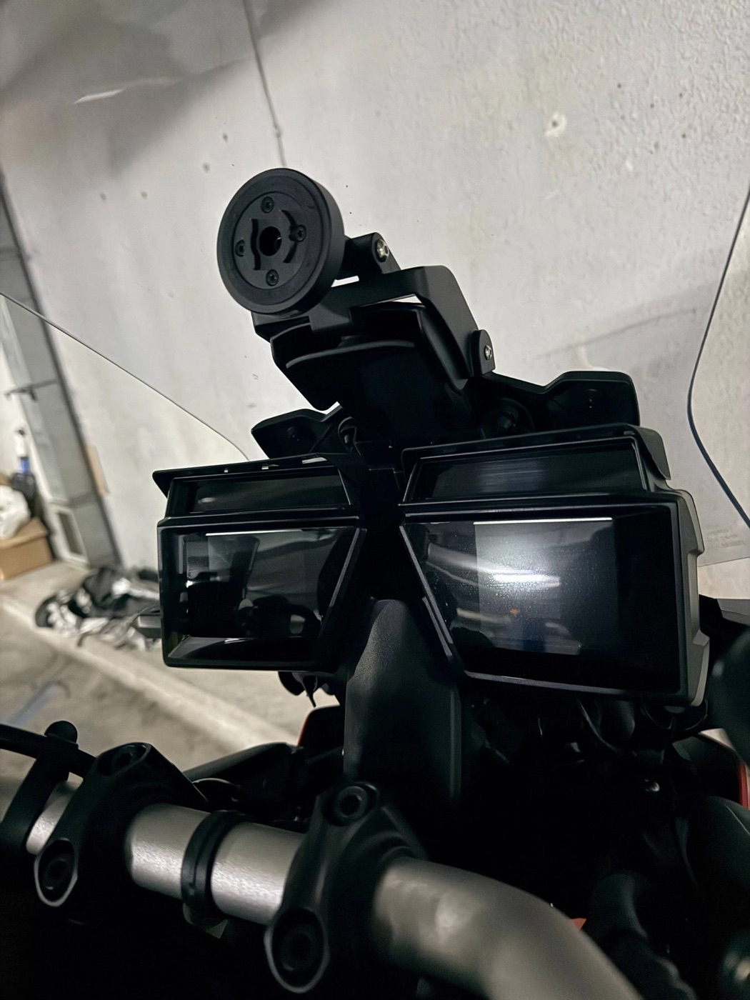

# The inertial unit

Four frames come from the inertial measurement unit (IMU), all at 100 Hz.

| Frame | Content | Status |
|---|---|---|
| [0x250](messages/0x250.md) | Accelerometer, 3 axes | confirmed |
| [0x254](messages/0x254.md) | Gyroscope, 3 axes | confirmed |
| [0x258](messages/0x258.md) | Packed fields, and a second pitch rate | hypothesis |
| [0x25C](messages/0x25C.md) | Not decoded | unknown |

## Axes and signs

The signs follow the usual vehicle convention (ISO 8855): x forward, y to the left, z up.

| Signal | Positive when |
|---|---|
| `accel_x` | the bike accelerates |
| `accel_y` | see below |
| `accel_z` | about +1 g upright at rest |
| `roll_rate` | the bike rolls to the right |
| `pitch_rate` | not verified under braking |
| `yaw_rate` | the bike turns left |

Lean angle is positive to the left while `roll_rate` is positive to the right, so the lean
angle falls when `roll_rate` is positive.

`accel_y` falls when the parked bike is tilted to the left. The lean angles in this repository
are positive to the left, so `lean_static = (7012.3 − raw) / 17.418`.

## Accelerometer, 0x250

Three big-endian 16-bit words in B0:B1, B2:B3 and B4:B5.

```
accel_g = (raw - 7000) / 992
```

- Zero is at about 7000 on every axis. The words are unsigned with an offset; they are not
  signed values around zero.
- The magnitude at rest is 991–993 counts on six rides, so 1 g is about 992 counts.
- The zero of each axis is known only to about ±20 counts (±0.02 g) and includes the mounting
  angle of the sensor. On this bike the upright zeros at rest were near 7056 (x) and 7012 (y).
  While riding on level road x sits at 7026–7029: the riding attitude is about 1.7° more
  nose-down than the parked one.
- On the move a phone accelerometer gives 993–999 counts per g on the x axis, the same as
  gravity. Against the derivative of wheel speed the slope is 1.07–1.11 instead, because the
  bike pitches with acceleration and the axis picks up part of gravity.
- The first frame after power-up is the reset value 7000, 7000, 8000.

At standstill the lateral axis gives the lean angle and the longitudinal axis the pitch angle.
The lean calibration was done by holding the parked bike at 19 angles while an iPhone fixed above
the dash showed the tilt in its built-in Measure app and a camera filmed the screen
(R² 0.998). In a corner this does not work, because the bike leans into the
resultant force; see [lean-reconstruction.md](lean-reconstruction.md).

B6 holds power-up flags (0x80 in the first frame, 0x60 for 0.4 s, then 0x20 for good). It is
not a "moving" flag, although it looks like one in short standstill captures.

## Gyroscope, 0x254

Three big-endian 16-bit words in B0:B1 (roll), B2:B3 (pitch) and B4:B5 (yaw).

```
rate_deg_s = (raw - 30000) / 100
```

Zero is at 30000, stable to a few counts across rides and months.

| Axis | Scale, counts per °/s | How it was measured |
|---|---|---|
| Yaw | 99.2–99.7 | GPS heading change over 15 whole turns of 30–71° |
| Roll | 95–107 | Two lifts off the side stand against the accelerometer angle (96.5, 97.9); phone gyro, fixed above the dash (105–107); phone gyro on the handlebar above 40 km/h (95–97) |
| Pitch | 97–100 | Phone gyro on the handlebar above 40 km/h; also tied to yaw within about 7 % by corner geometry, see below |
| Yaw, second check | 96–104 | Phone gyro on the handlebar above 40 km/h |

The numbers are consistent with a design value of 0.01 °/s per count and an offset of 300 °/s.
We publish 100 for all three axes. Individual turns scatter by about 4 % for yaw; roll and
pitch are known to a few percent. The handlebar figures come from one cold-day ride with the
phone on the handlebar, fitted on all three axes at once; below 40 km/h steering moves the
phone and the fit degrades, so only the faster part is used.

**Pitch rate in a corner.** In a steady corner the pitch word sits about 1000 counts away from
neutral. It is tempting to call that cross-talk. It is geometry: a sensor that is leaned over
sees part of the turn on its pitch axis, `pitch = −yaw × tan(lean)`. With lean taken from the
reconstruction, the measured slope of that relation is between 0.98 and 1.07. This is also what ties the pitch scale to the yaw
scale.

**B6 and B7** are always equal to each other. The value drifts slowly. It is not a rolling
counter and not a checksum of the other bytes; we do not know what it is.

## 0x258 and 0x25C

Not decoded, with one exception: 0x258 B6:B7 is a second pitch rate, in the same encoding as
0x254. It follows the 0x254 pitch rate with the cornering term `−yaw × tan(lean)` removed, one
frame later; on a ride with gentle corners, where that term is small, the two correlate at
0.92–0.94 but differ by about 170 counts sd, so it is filtered or sourced separately. To remove
the cornering term, the IMU must know the lean angle.
So the unit most likely estimates its own attitude, and the remaining bytes of these two
frames are the first place to look for it. Details on the message pages and in
[open-questions.md](open-questions.md).

## What all of this rests on

Almost every angle and rotation-rate figure on this page comes back to one reference: an iPhone
in an SP Connect mount above the dash, behind the windscreen, always in landscape orientation.
The mount is on the body of the bike,
not on the handlebar, so the phone leans and turns with the frame and steering does not move
it. It has a vibration damper, so the coupling is firm but not perfectly rigid. The exception
is one later ride with the same phone in an SP Connect mount on the centre of the handlebar,
also damped; it turns with the steering, so only data above 40 km/h is used from it.


 The static lean calibration used its level filmed by a camera;
the roll scale and the lean comparison used its recorded attitude and gyro; the yaw scale used
its GPS heading. We have no other measurement of the bike's real angle. The raw IMU words are
facts; the scales and angles derived from them are as good as that phone and its mount, and no
better.

Two checks do not depend on the phone: gravity fixes the accelerometer scale, and the relation
between the pitch and yaw gyros in a corner ties those two axes to each other.

## What has not been checked

- The pitch sign under braking.
- Anything against a rigidly mounted reference IMU. The phone used as a reference sat on the
  body of the bike above the dash, and once on the handlebar.
- Temperature drift of the zeros.
