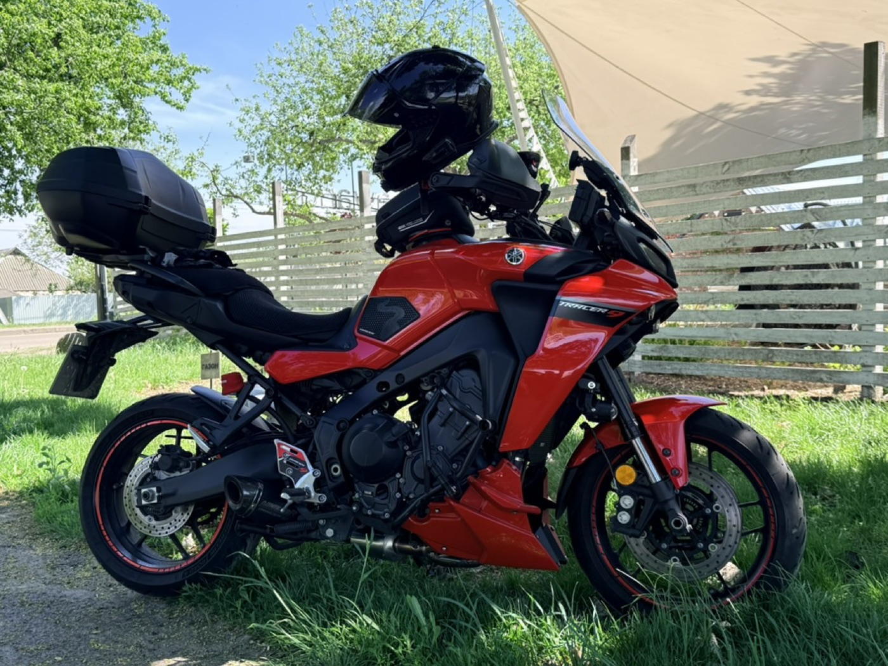
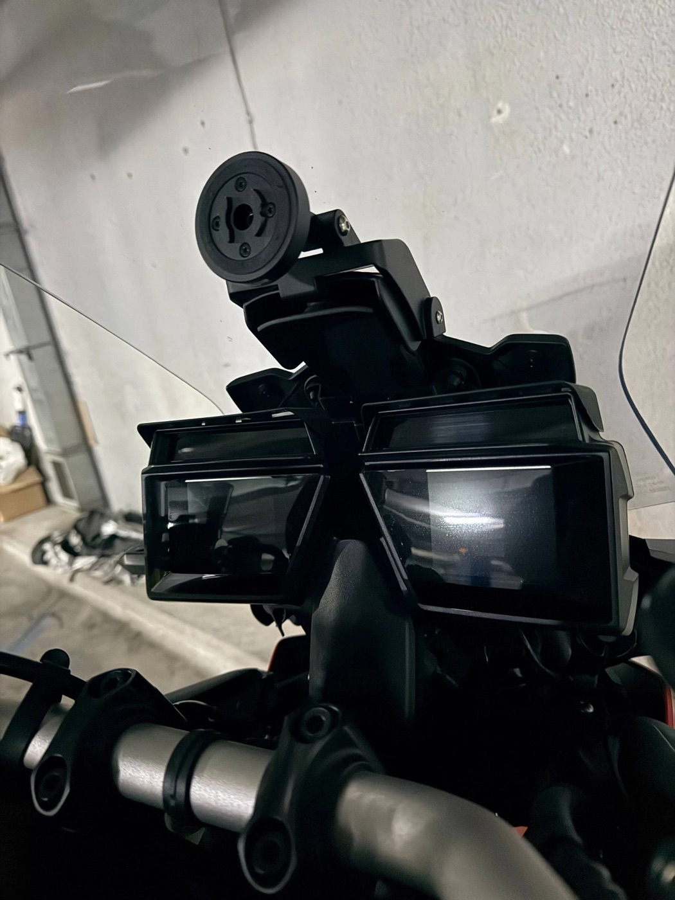

# Methods

How the data in this repository was obtained, what each value rests on, and how far it can be
trusted. Written so that a reader can judge the evidence without taking our word for it, and
repeat the work on another motorcycle.

Nothing here comes from manufacturer documentation. Every value was derived from recordings
of one motorcycle, compared with an independent reference where one could be arranged.

## 1. Subject

One Yamaha Tracer 9 (base model, RN70, model year 2022, EU market, Euro 5), ridden on public
roads by its owner. Every recording in this repository was made on this motorcycle.

The electronics are as delivered by the factory: control units, sensors, wiring and software
were not changed. One part that matters here is not standard. For every recording the bike
carried an aftermarket full exhaust system: the
[Dominator "Full Exhaust System Collector + Silencer HP8 BLACK EX" with the medium dB-killer](https://dominator.pl/en_US/p/Yamaha-Tracer-9-GT-2021-2024-Full-Exhaust-System-Collector-Silencer-HP8-BLACK-EX-dB-killer-medium/3051),
a stainless-steel system for the Tracer 9 / GT 2021–2024. The maker gives 102 dB without the
dB-killer and a reduction of about 2–4 dB with it. The system has three header pipes, a
collector with an additional chamber, and the silencer. According to the owner it is a
straight-through system with **no catalytic converter**; the maker's page does not say
either way. A top case and bags were also fitted.

What the exhaust could affect, and what it could not:

- **Engine-side values read over OBD-II**: fuel trims, the oxygen sensor voltage, intake
  pressure and calculated load may differ from a bike with the standard exhaust, all the more
  so without a catalytic converter. Their encoding does not.
- **The `load_counter` in 0x23E**, if it is a fuelling quantity.
- **The video-to-log alignment** uses the exhaust note. Its frequency is set by the engine
  (`rpm / 40` Hz) whatever the silencer, so the method holds; only the loudness differs.
- **Everything else** (frame layouts, scales, wheel speeds, IMU, ABS, settings) does not
  depend on the exhaust.

## 2. Instruments

| Instrument | Role | Notes |
|---|---|---|
| CAN logger | Records every frame with a timestamp | ESP32-S3 (TWAI controller), SN65HVD230 transceiver, at the diagnostic connector, normal mode (it acknowledges frames). 1 ms timestamps. Writes raw bytes to an SD card; no decoding on the device. |
| Helmet camera | Record of what the rider did and saw | DJI action camera, 3840 × 2160 at 59.94 frames per second, running for the whole ride. |
| Wireless microphone | The rider's spoken markers | DJI Mic Mini. |
| Phone on the bike | Angle, speed and heading reference | iPhone 16 Pro, always in landscape orientation, in an SP Connect mount with its vibration damper, on a bracket above the dash, behind the windscreen (photo below). The bracket is on the body of the bike, not on the handlebar, so steering does not move the phone. Two uses: the built-in Measure app (level) filmed by the camera; later the Sensor Logger app recording attitude at 50 Hz and GPS at 1 Hz to files. |
| Instrument cluster | Reference for speed, gear, riding mode, TCS level, coolant temperature | Read from the video. |
| OBD-II on the same bus | Reference for engine speed and coolant temperature | Standard PIDs polled by the logger while it also records the broadcast frames. |

*Where the reference phone sat: above the instrument cluster, behind the windscreen, on a
bracket fixed to the body of the bike. The handlebar is in the foreground and is not connected
to it.*

The logger stores raw bytes only. All decoding is done afterwards on a computer, so when a
formula turns out to be wrong the old recordings are simply decoded again. That happened more
than once.

## 3. References and their limits

A decoded signal is only as good as what it was compared with.

| Reference | Used for | Resolution and known limits |
|---|---|---|
| OBD-II PID 0x0C (engine speed) | 0x209 `engine_rpm` | 0.25 rpm steps. Polled every 100 ms, so pairs during fast changes scatter by up to 10 %; steady pairs are used for the comparison. |
| OBD-II PID 0x05 (coolant) | 0x23E `coolant_temp` | 1 °C steps. Same ECU as the broadcast frame, so this checks the encoding, not the sensor. |
| Phone GPS Doppler speed | 0x205 wheel speeds | 1 Hz. Lags by about a second, removed by cross-correlation. Only samples with horizontal accuracy under 20 m and steady speed are used. |
| GPS heading | 0x254 yaw scale and sign | 1 Hz, so only whole turns are compared, not instantaneous rates. |
| Phone attitude (Sensor Logger) | Lean angle | 50 Hz. A sensor fusion of the phone's own gyro and accelerometer. Fixed to the body of the bike, so it follows the frame and not the steering. Not an instrument-grade reference. |
| Phone level (Measure app), filmed | Static lean; first cornering checks | Read from video by hand to 1°. |
| Published gearbox ratios | 0x209 gear | Exact numbers; the comparison is free of any scale of ours because only ratios between gears are used. |
| Dash, filmed | Speed cross-check, gear, mode, TCS level, coolant | Whole-number display. The dash speedometer reads about 9 % high. |
| Rider's spoken marker | Brake pedal and lever use, mode changes, ABS events, manoeuvres | Timing good to about a second; what was said is unambiguous. |

## 4. Recordings

| Kind | What | Used for |
|---|---|---|
| Parked sessions, filmed | Ignition cycles, stepping through riding modes and TCS levels, brake lever and pedal presses, bike held at set lean angles | Finding switch-like signals; static lean calibration |
| Full-rate ride captures | Every frame of whole rides, up to 42 minutes and 2.7 million frames each | Rates, layouts, wheel speeds, ABS events, IMU, gear ratios, the re-derivation in section 9 |
| Long-ride logs | Rides of up to several hours with raw frames sampled once a second and decoded values at 50 Hz | Checking that a reading holds across many hours and conditions |
| Ride with phone logging | One ride of about an hour with phone GPS, attitude and gyro recorded | Wheel-speed scale, yaw scale and sign, lean angle |
| OBD-II sessions | Three sessions requesting every mode 01 and mode 09 identifier | [obd2.md](obd2.md) |
| UDS scan | One read-only scan of two control units | [uds.md](uds.md) |

Captures cover one riding season and coolant temperatures from 13 to 98 °C. Some early
captures were logged over Bluetooth and stored only frames that changed; they are used for
switch-like signals and never for rates or statistics.

Short excerpts of the full-rate captures are published in [captures/](../captures/). The
video, the phone recordings and the complete logs are not published, because they show where
and when the owner rides.

## 5. Procedure

### On the bike

The bytes on the bus say nothing about what the rider was doing, so every session records
that separately.

- The camera and microphone run for the whole session. Before each action the rider says what
  is coming: which brake, which gear, which setting is being changed and to what.
- Settings are changed with the dash in the frame, so the video shows the value the bike itself
  displays.
- One thing is changed at a time. A test that changes two things proves neither.
- Events that cannot be produced on demand are provoked deliberately and announced. ABS was
  tested with intentional hard stops; the rider called each intervention as he felt it, and
  the pulsing is also audible on the recording. One stop was made with the rear brake alone.
  The hard front stops also had the rear pedal down, so they are not front-only.
- A written plan lists the actions and the open question each one settles.

Afterwards the video is watched next to the log. For each spoken marker we look at which bytes
changed in the seconds around it, and whether they change the same way every time the action
is repeated.

### Aligning video and log

Camera and logger have separate clocks, and the difference drifts. The engine provides the
alignment. A three-cylinder four-stroke fires 1.5 times per revolution, so its exhaust note is
at `rpm / 40` Hz. The spectrogram of the sound track is matched against `engine_rpm` from frame
0x209. On 20-minute clips this gives the offset with a residual of 5–9 ms, less than one video
frame, and the clock drift (the camera clock gains 50–90 parts per million relative to the logger).

Phone recordings are aligned with the log by cross-correlating speed (peak correlation 0.998).

### Finding a signal

1. **Switch-like signals:** look for bits that change at each spoken marker and change back
   when the action is undone, every time.
2. **Continuous signals:** correlate the reference with every byte and every 16-bit word of
   every ID, big- and little-endian, signed and unsigned, and inspect the best candidates by
   eye.
3. **Check the neighbouring byte.** The low byte of a 16-bit word looks like a lively signal
   that wraps around; the high byte looks like a coarse step. Brake pressure, throttle and the
   ABS speed word were each first misread as a single byte.
4. **Fit** scale and offset against the reference by least squares, and look at the residuals
   across the range instead of trusting the correlation coefficient.
5. **Test on a recording that was not used to find it.**

## 6. What each value rests on

The message pages give the evidence signal by signal. This table is the overview. "n" is the
number of independent comparisons, not the number of frames.

Conventions: "sd" is the standard deviation of the residuals (one sigma). A range such as
99.2–99.7 is the spread between ways of pooling the same comparisons, and "±" after a mean is
the spread between sessions; neither is a confidence interval. "Steady" means speed or angle
changing slowly over the comparison window; the thresholds differed between analyses. Gear
constants are in rpm per km/h of rear wheel speed.

| Quantity | Reference | Method | n | Result | Uncertainty and limits |
|---|---|---|---|---|---|
| Frame rates, DLC | Logger timestamps | Frame count over the time between first and last frame of each ID, full-rate captures | 6 captures | 100.0 / 10.0 / 1.0 Hz | 1 ms timestamps; longest gap between frames of a 100 Hz ID 31 ms |
| Engine speed | OBD-II PID 0x0C | Paired with the latest broadcast frame | 96 pairs, 3 sessions | × 25/64; median difference +0.1 % | Steady pairs within 0.3 %; checked at standstill and low speed only |
| Gear (sensor) | Published gearbox ratios | rpm ÷ rear wheel speed per gear, normalised to 3rd | 6 gears, 5 rides | Ratios between gears agree with the published ones within 0.3 % | Field never reads 7; reads 0 with the engine stopped |
| Gear (shift mechanism) | Gear changes and the dash | Value 7 episodes against gear changes; dash gear with the engine stopped | 74 episodes on one ride; pattern repeated on a second | 0–6, 7 between gears | 1↔2 changes show no 7 |
| Riding mode | Dash in the frame, spoken marker | Rider steps through the modes in a known order | 2 parked sessions | 2-bit field, 0–3 = modes 1–4 | The three copies agree on every ride |
| TCS mode | Dash in the frame, spoken marker | As above; then agreement between copies | 13 changes across sessions; 9 more filmed later | 1, 2, 3 = TCS 1, 2, M | Level 0 probably OFF, not confirmed |
| TCS level in effect | The rider's own M setup; the dash for the presets | Mode and level compared in M with the level set to 2, then raised to 3 | 796 000 paired frames, 1 day | Separate field; equals the mode except in M | Copied by 0x209, which earlier rides could not separate from the mode |
| Quickshifter UP / DOWN on, BC mode | Dash in the frame | Each setting switched in the menu and back | 1 session, 2 changes each | 1 bit, 1 bit, 2-bit field | Field changes on accept, not on highlight |
| Wheel speed scale | Phone GPS Doppler | Least squares through the origin on steady pairs | 181 pairs, 17–135 km/h, 1 ride | 100.8 raw per km/h (we use 101.0) | Residual sd 0.4 km/h; ratio drifts 0.8 % with speed; one set of tyres |
| — cross-check | Dash, filmed; dash against GPS | Log against dash (48 pairs, 11–170 km/h) and dash against GPS (103 pairs) | 2 further rides | 101.0 | Chained through the dash; agrees with the direct result |
| Rear against front wheel | Each other | Ratio at steady speed | 2313 windows, 1 ride | Within 0.2 % below 60 km/h, +1 % above 100 | — |
| Throttle grip | Mechanical stop | Fully open plateau; closed flag | 4 rides | 0 closed, 690–696 open | No independent position reference; percent assumes a linear sensor |
| Throttle valve | — | Separation from grip under cruise, low rpm and quickshift | 1 ride at full rate | 14 idle, 697 stop | Hypothesis: no independent reference |
| Front brake pressure | Rider action, spoken | Lever squeezes at standstill; hard stops; front lever then rear pedal at standstill | 6 rides | 16-bit word, 0 released, front circuit only | Raw units only; no pressure gauge |
| Brake light switch | Rider action, spoken | Deliberate presses at standstill, then counted on rides; front lever then rear pedal at standstill | 120 presses, 2 rides; 4 + 4 in one test | 1 bit, either brake | The front lever switch closes only at moderate pressure |
| ABS rear | Rider's call, audible pulsing, wheel speeds | Flag against rear-wheel dip | 1 controlled stop, 1 called event, 3 more on a long ride | 1 bit | Includes lock-up from engine braking with no brake applied |
| ABS front | Rider's call, audible pulsing, pressure, wheel speeds | Flag against deliberate hard stops | 3 events on 2 rides | 1 bit | Few events; confidence medium |
| ABS unit speed word | 0x205 front wheel | Ratio of the two words | 190 000 frames, rides months apart | ÷ 17.7 = km/h | Tied to 0x205, not measured against GPS separately |
| Coolant temperature | OBD-II PID 0x05; dash | Least squares; dash on video | 132 pairs, 6 sessions, 13–98 °C; 1 dash reading, then 11 more at 77–85 °C | 0.625 × raw − 30 | Max error 1.0 °C against a 1 °C reference; the dash shows floor() of it |
| Air temperature | Dash on video | Readings while moving | 13 readings, 8–11 °C, 1 ride | 0.625 × raw − 30 | Dash holds its value at a standstill |
| Accelerometer scale | Gravity | Magnitude of the three axes at rest | 6 rides | 992 ± 2 counts per g | Axis zeros known to ± 20 counts |
| Static lean | Phone level, filmed | Bike held at set angles | 19 angles | 17.418 counts per degree, R² 0.998 | Standstill only |
| Longitudinal acceleration | Wheel speed; phone accelerometer | Correlation with its derivative; sign against GPS speed change; fit against the phone | 1 ride each; 2 recordings | r 0.97; sign 93 %; 993–999 counts per g | Riding zero 7026–7029, not the 7056 of a parked bike |
| Yaw rate scale | GPS heading | Integrated rate against heading change over whole turns | 15 turns of 30–71° | 99.2–99.7 counts per °/s | Individual turns scatter about 4 % |
| Yaw sign | GPS course | Sign of rate against course change | 124 samples above 5 °/s; 15 turns | Positive = left, 98 % and 15 of 15 | — |
| Roll rate scale | Accelerometer angle; phone gyro | Integrated rate over a side-stand lift; regression | 2 lifts; 2 rides | 95–107 | Known to about 7 % |
| Pitch rate scale | Phone gyro on the handlebar; yaw rate and the reconstructed lean | 3-axis fit above 40 km/h; corner offset against −yaw × tan(lean) | 2 recordings; 2 rides, 2 sample captures | 97–100; slope 0.98–1.07 | Phone turned with the handlebar; sign under braking not verified |
| Lean angle (reconstructed) | Phone attitude, 50 Hz | Comparison in steady corners | 197 s, 1 ride, 8–30°, 30–120 km/h | Slope 0.99, residual sd 2.8° | Constant uncertain by about 10 %; see [lean-reconstruction.md](lean-reconstruction.md) |
| OBD-II PIDs | The ECU's own answers | Request and response captured | 3 sessions | [obd2.md](obd2.md) | Decoded with the standard formulas; not checked against instruments |
| UDS identifiers | The units' own answers | Request and response captured | 1 scan | [uds.md](uds.md) | — |

## 7. Values reached by more than one route

A number found one way can be an accident of that method. The values we trust most were
reached by routes that share as little as possible. For each case the table says which routes
are independent and which are not, because agreement between two routes with a common source
proves less than it seems.

| Value | Routes | How independent |
|---|---|---|
| Wheel-speed scale, 101 raw per km/h | (1) Predicted before it was measured: the log against the dash speedometer on video (48 pairs, 11–170 km/h) chained with that dash against GPS on a ride a year earlier (103 pairs) gave 101.0. (2) Phone GPS on a later ride then gave 100.8–101.3 (181 to 249 steady pairs, depending on the filter). (3) Engine speed per km/h in each gear, with the published primary and final ratios and the nominal tyre circumference (1.979 m), showed the earlier scale of 89.1 over-reading by 9 %; GPS says 13 %. The gap would correspond to a loaded rolling circumference of about 1.90 m, which we did not measure. (4) The ABS unit's own speed word (0x268) is 0.1757 times the wheel word on every ride. | (1) and (2) both end at phone GPS, but with different phones, apps, rides and years; in (1) the GPS speed was read from a navigation app on screen. (3) uses no GPS and no dash; it confirms the direction and rough size of the correction, not the value. (4) is a second word from the same unit; it checks consistency, not scale. |
| Engine speed, × 25/64 | (1) OBD-II PID 0x0C. (2) The exhaust note on the camera sound track sits at rpm / 40 Hz; with this scale the sound aligns with the log to a few milliseconds over 20-minute clips, at 20–27 standard deviations above the background. (3) Engine speed divided by wheel speed matches the engaged gear's ratio in 99.9 % of samples on a six-hour ride. | (1) is the same ECU reporting twice. (2) is physics: acoustics against the logged number, with nothing of ours in between. (3) is not a separate check of the factor: it shows that rpm and wheel speed are consistent with each other in every gear. |
| 1 g = about 992–998 counts | (1) Gravity: magnitude of the three axes at rest, 992 ± 2 on six rides. (2) Fit of the lateral axis against the phone level at 19 angles: 17.418 counts per degree, which is 998 per g. (3) A separate fit of the vertical axis on the same sessions: 996. | (1) needs no reference at all. (2) and (3) share the phone and the sessions. Three routes; the spread, 992 to 998, is the honest uncertainty. |
| Longitudinal accelerometer zero, 7056 at rest | Bike on the centre stand; bike on level ground; 5600 samples at stops in the middle of a ride (median 7057). While riding on level road the zero is lower, 7026–7029 on four rides of one day, at zero wheel acceleration. | The three rest values are different physical situations, months apart. The riding value is a different attitude, not a contradiction. |
| Gyro zero, 30000 | Medians of four sessions (29 993 to 30 002); eight stops within one ride (0 to 5 counts off). Consistent with the reset frame, which reads exactly 30000. | Independent sessions; no reference needed. |
| Gyro scale, 100 counts per °/s | (1) Yaw against GPS heading over 15 turns: 99.2–99.7. (2) Yaw against the phone's gyro: 99–102. (3) Roll against the accelerometer over two side-stand lifts: 96.5 and 97.9. (4) Pitch against yaw through corner geometry: slope 0.98–1.07. (5) All three axes against the phone's gyro on the handlebar above 40 km/h, a later ride: roll 95–97, pitch 97–100, yaw 96–104. | (1) and (2) share one phone and one ride. (3) uses neither phone nor GPS. (4) links two axes of the same sensor through the reconstructed lean, so it cannot catch an error common to both and is not independent of the lean constant. (5) uses the same phone on another ride and another mount. |
| Yaw sign, left positive | Direction of turns identified blind on video on two rides; GPS course on a third (15 of 15 turns); agreement with the roll and accelerometer signs under the usual vehicle axis convention. | Video and GPS are independent of each other. |
| ABS flags | The rider's call on the sound track; the audible pulsing; the wheel-speed signature (one wheel word drops while the other holds); brake pressure at the same moment; a stop made with the rear brake alone. | Only the sound track is outside the bus. Wheel speeds, pressure and the flags probably all come from the ABS unit, so their agreement shows consistency, and the meaning rests on the sound track and on which brake the rider used. |
| Brake light bit | Announced presses of the rear pedal; a standstill test with the front lever and then the rear pedal, both of which set it; a second frame (0x22A) from elsewhere on the bus carries a bit that agrees in 99 % of frames. | The second frame is corroboration from the bus, not an outside reference. |
| Riding mode, TCS mode and level | The dash on video with spoken markers; then two or three copies in different frames that never disagree outside start-up; the observed rule that TCS M is only ever entered or left at 0 km/h, which is how the bike's menu works. | The copies come from the same unit and prove consistency, not meaning. The meaning rests on the video. |
| Brake control mode | Sent by the engine ECU (0x226) and repeated by the ABS unit (0x268): equal in 414 370 of 414 370 paired frames; BC1 and BC2 switched in the menu with the dash filmed. | Two different units agree on the value; the meaning rests on the video. |
| Coolant, 0.625 × raw − 30 | OBD-II (28 pairs at first, 132 in the refit); one dash reading on video, then 11 more on another ride. | OBD-II and the dash share the sensor with the broadcast frame; they confirm the encoding. |
| Engine software number | OBD-II mode 09 (ASCII) and UDS identifier 0xF194 (BCD) return the same eight digits. | Two services of one unit. |
| Ignition-on counter | It advances 85 in 84.3 s inside one session, and by four hours over four calendar days. | The first shows the unit is seconds; the second is consistent with counting only with the ignition on. |

### Where routes disagreed

The disagreements taught more than the agreements.

- **Wheel-speed scale, 89.1 against 101.0.** The first scale was anchored to the ABS unit's
  speed byte, assuming it stepped 16.67 km/h. It read 13 % high. The gear-ratio route and the
  dash showed the excess, and the assumption turned out wrong: that byte is the high half of a
  16-bit word.
- **Lean constant.** The first fit used slow corners and the wrong speed scale. It was rescaled
  together with the speed scale; a refit on a full ride puts it 3–10 % higher than the value we
  use. Unresolved within that range.
- **Yaw sign.** One early ride, with the phone level as reference, implied the opposite sign
  to the video. GPS course settled it in favour of the video. The likeliest cause of the early
  result is the orientation of the phone on that ride; that was not verified.
- **Brake pressure and throttle as single bytes.** Both "worked" for weeks: the bytes were
  lively and filled their whole range, which we took as proof. Both were the low halves of
  16-bit words and wrapped around at 255.
- **How much the lateral accelerometer shrinks in a corner.** Three analyses gave factors of
  4–5, 6 and 8.6. They agree that it is useless for lean on a moving bike and not on the
  number.
- **Side-stand angle.** Sessions give anything from 11° to 15° for the bike on its side stand,
  and in one early session the phone read 14° where the calibrated formula gave about 11°. The
  ground and the handlebar position change how the bike sits on its stand, which explains a
  spread but not a 3° disagreement within one session. Not pursued.
- **Two "engine running" flags that agreed with each other** (0x23A and 0x401) and were both
  wrong. Agreement between two signals that were never tested against the engine proved
  nothing.

## 8. What counts as confirmed

A signal is **confirmed** when it agrees with an independent reference and the agreement was
reproduced on a second recording. **Confidence** then says how
strong that is: high for several rides and a good reference, medium for one ride, one
reference or a scale known to a few percent, low for thin evidence.

Two special cases. A field that equals a confirmed field in every paired frame on at least two
recordings is confirmed **as a copy** of it, with no higher confidence than the original; its
"confirmed by" line says so, and nothing outside the bus backs it. A field that never changed
in any recording is **unknown**, not confirmed, however reliably it reads zero.

For OBD-II and UDS, confirmed means the unit answered with the same encoding in at least two
sessions and the standard formula gives a plausible value. Only PIDs 0x0C and 0x05 were
compared with anything else, so the others carry medium confidence.

Everything else is a **hypothesis**, however convincing the pattern. A reading that was
disproved stays in the database as **ruled out**, with the reason.

Decodes published for other motorcycles are not evidence here. Before publishing we compared
our results with the ones we could find; what agrees and what does not is in
[prior-art.md](prior-art.md).

## 9. Independent re-derivation

Before publication every confirmed signal was derived again in a second pass: newly written
analysis working from the raw recordings and the list of claims, not from the original
analysis, and on recordings other than those first cited. The aim was to break
each claim. Results that did not reproduce were downgraded or corrected:

| Earlier reading | What the data shows |
|---|---|
| 0x23A B0 = engine stopped / running | A flag set briefly after the bus wakes |
| 0x401 0x80 = engine running | Set only after the ignition is switched off |
| 0x250 B6 bit 6 = bike moving | A power-up flag |
| 0x268 B1 = low speed | "Has not moved since power-on" |
| 0x268 B2 = speed in 16.7 km/h steps | High byte of a 16-bit speed word; the old formula read 15 % high |
| 0x209 B5 = drive / overrun / shifting | More likely quickshifter up / down availability |
| 0x22A carries nothing | One bit is the brake light switch (front or rear) |
| All fast frames run at 98 Hz | Exactly 100 Hz; the count had been divided by the wrong duration |
| Coolant = (raw − 49) / 1.57 | 0.625 × raw − 30 fits the same data better |
| Four OBD-II PIDs listed as confirmed | They had never been requested |

Most of these share one cause: a reading made on short or stationary recordings that was
never tested on a long ride. A flag that changes once per session looks like whatever happened
to change at that moment.

The repository was then given to a reader with no access to anything else, who decoded the
sample captures from the documentation alone and reported every place where the captures did
not support the text. Those places were corrected.

## 10. Sources of error

- **One motorcycle, one rider.** Nothing here is replicated on a second vehicle. Scales that
  depend on the bike (tyre size, sensor zeros) are specific to it.
- **Single-ride results.** The GPS speed comparison and the lean comparison each rest on one
  ride. They are marked medium confidence where no second line of evidence exists.
- **The lean reference is a phone.** Its attitude is a consumer sensor fusion, and it is the
  only measurement of the bike's real angle we have. It was fixed to the body of the bike, so
  steering did not disturb it, but through a vibration damper, which lets the phone move a
  little against the bike. We have not measured how much. Agreement to 2.8° says the two methods agree, not that either
  is exact.
- **Circular references.** OBD-II values come from the same ECU that sends the broadcast
  frames. They verify how a value is encoded, not that the sensor is right.
- **Selection.** Hand-picked moments from video favour clean, memorable events. The later
  whole-ride comparisons were made to remove this.
- **States never entered.** TCS off (deliberately), fault codes present, a low battery, a wet
  ABS stop, steady lean above 30°, speeds above about 170 km/h.
- **Inferred senders.** The harness was not opened. Which unit sends which frame is a guess.
- **The logger acknowledges frames** and its transceiver board carries a termination resistor.
  The bus was therefore never observed undisturbed.

## 11. Traps worth knowing

- **Start-up frames.** The first half second after power-on contains reset values that look
  like data. See [bus.md](bus.md).
- **Change-only logs.** A log that stores only changed frames makes a continuously sent frame
  look event-driven and a constant frame look absent.
- **Simulated data.** We test the logger against a simulated bus built from our own
  documentation. Such recordings agree with the documentation by construction and are never
  evidence.
- **One-bit flags and coincidence.** A bit that is set during every hard stop may be about
  braking, deceleration, a closed throttle or a downshift. Split the data by something
  independent (gear, for instance) before naming it.
- **Clock domains.** If frames and event markers are stamped from different clocks, a fixed
  offset between them can hide for months.

## 12. Checking our work

The sample captures are enough to verify, without any other data: every frame rate and DLC;
the gear constants; the copies of mode and TCS level; the wheel-speed signature of the ABS
events; the power-up and shutdown sequences; the corner offset of the pitch gyro; and that the
decoder and the DBC give the same numbers.

They are not enough to verify anything that needs the references: the wheel-speed scale, the
gyro scales, the lean comparison and the coolant fit. For those the numbers above are our
report of comparisons you cannot rerun. A capture from your own bike with your own reference
is the real check, and a disagreement is worth an issue.
